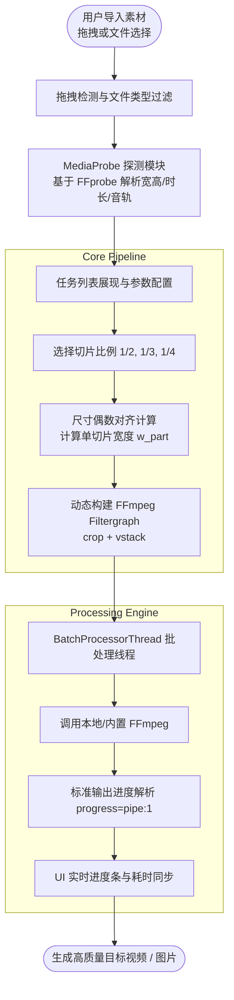

<div align="center">


# Asset Splicer (素材分割拼接工具)

**高效、开箱即用的 Windows 桌面端多媒体素材垂直等分与上下堆叠拼接工具**

[](https://www.python.org/)
[](https://www.qt.io/)
[](https://ffmpeg.org/)
[](LICENSE)
[](https://microsoft.com)
[]()

[功能特性](#-功能特性) • [系统架构](#-系统架构) • [快速上手](#-快速上手) • [独立打包](#-打包发布) • [目录结构](#-目录结构) • [开源协议](#-开源协议)

</div>

---

## 📖 项目简介

**Asset Splicer** 是一款专为自媒体创作者、剪辑师及视觉开发者打造的轻量级多媒体批量处理桌面应用。

许多分屏对比、多视角同步、短视频切片二次排版需求需要将宽屏视频（或横版图片）按照水平等分分割为若干等宽局部，并自上而下重新堆叠拼接（Vertical Stack）成竖屏或长图。手动在剪辑软件中建立轨道、反复裁剪排版不仅繁琐且效率低下。

Asset Splicer 基于 **PySide6 (Qt6)** 与 **FFmpeg Filtergraph** 流水线构建，提供友好的暗黑质感 GUI 操作界面，支持多媒体素材批量拖拽、比例选择、自适应全貌对比预览以及多线程队列批处理，让素材分割拼接一键搞定。

---

## ✨ 功能特性

- 🎞️ **全媒体格式支持**：
  - 视频支持：`.mp4`, `.mkv`, `.mov`, `.avi`, `.webm` 等格式。
  - 图片支持：`.png`, `.jpg`, `.jpeg` 等主流位图格式。
- ✂️ **灵活分割与垂直重排**：
  - 支持 **1/2**、**1/3**、**1/4** 等分切片。
  - 采用 FFmpeg `crop` 动态切片与 `vstack` 滤镜流水线，自上而下重新编排。
  - 自动执行偶数像素对齐计算（Even Dimension Check），规避 H.264/YUV420p 奇数分辨率编码报错。
- ⚡ **高清保真与音频直通**：
  - 视频采用 `libx264` 高质量参数（`CRF 18`、`preset=fast`、`yuv420p`），保留细腻画质。
  - 智能探测输入音频流，默认采用音频直通无损复制（`-c:a copy`），兼顾音质与转码速度。
- 👁️ **自适应全貌对比预览**：
  - 内置专属预览引擎，单帧秒级生成效果图。
  - 弹窗内展示**原始素材全貌**与**拼接后效果**的自适应等宽等比排版，支持一键在系统相册/看图工具中全屏核验。
- 📦 **免安装绿色便携 (Portable)**：
  - 优先探测本地 `tools/` 目录中的 `ffmpeg.exe` 与 `ffprobe.exe`，无需用户全局安装配置环境变量；
  - 亦可自动回退检测系统全局 `PATH`，兼容性极佳。
- 🎨 **现代暗黑风桌面 UI**：
  - 沉浸式暗色主题，原生支持 Windows 高分屏 High-DPI 缩放（PassThrough 策略）。
  - 支持文件及整个文件夹直接拖拽导入、智能去重及任务列表快速清理。
  - 批处理任务队列可视化，支持实时进度条反馈、耗时统计与运行状态指示。
- 🚀 **一键独立打包分发**：
  - 配套完善的 Nuitka 自动化编译构建脚本，可独立生成脱离 Python 环境的 Windows 绿色便携发布包。

---

## 🛠️ 系统架构



---

## 🚀 快速上手

### 1. 环境准备

- **操作系统**：Windows 10 / Windows 11 (x64)
- **Python 环境**：Python 3.11+
- **多媒体引擎**：FFmpeg 与 FFprobe（5.0+ 推荐）

### 2. 获取代码与依赖安装

推荐使用现代 Python 包管理器 [uv](https://github.com/astral-sh/uv) 或原生 `pip`：

```bash
# 克隆仓库
git clone https://github.com/942030451/AssetSplicing.git
cd AssetSplicing

# 方式 A：使用 uv（推荐）
uv venv
.venv\Scripts\activate
uv sync

# 方式 B：使用标准 pip
python -m venv .venv
.venv\Scripts\activate
pip install -e .
```

### 3. 配置 FFmpeg 工具链

本程序采用优先读取本地便携工具的设计：

1. 下载 64 位 Windows 版的 [FFmpeg 构建包](https://www.gyan.dev/ffmpeg/builds/)。
2. 将解压得到的 `ffmpeg.exe` 与 `ffprobe.exe` 放入项目的 `tools/` 目录下：
   ```text
   AssetSplicing/
   └── tools/
       ├── ffmpeg.exe
       ├── ffprobe.exe
       └── README.md
   ```
> 注：若已将 FFmpeg 添加至系统环境变量 `PATH`，程序亦可自动识别。

### 4. 运行程序

在激活的虚拟环境中执行：

```bash
python -m app.main
```

---

## 📦 打包发布

本项目提供基于 **Nuitka** 的独立便携包构建脚本，可将整个应用及其依赖编译为免安装的 Windows 绿色发布包：

```bash
# 执行自动化打包
python build/build_nuitka.py
```

构建完成后，可执行程序与便携运行环境将自动重整至：
`dist/AssetSplitter_Portable/`

包含结构：
```text
dist/AssetSplitter_Portable/
├── AssetSplicer.exe      # 独立可执行主程序
├── tools/                # 自动携带的 ffmpeg 与 ffprobe
│   ├── ffmpeg.exe
│   └── ffprobe.exe
└── ...                   # 依赖运行库与静态资源
```
直接压缩 `AssetSplitter_Portable` 目录即可分发给最终用户，无需安装 Python 环境。

---

## 📂 目录结构

```text
AssetSplicing/
├── app/                      # 应用程序源码
│   ├── core/                 # 核心底层模块
│   │   ├── pipeline.py       # FFmpeg 命令行与 Filtergraph 流水线构建器
│   │   ├── probe.py          # 媒体元数据探针 (FFprobe)
│   │   └── worker.py         # 多线程批处理执行器与进度解析器
│   ├── resources/            # 静态资源 (应用图标等)
│   ├── ui/                   # 桌面 GUI 模块 (PySide6)
│   │   ├── drop_zone.py      # 文件拖拽导入区
│   │   ├── main_window.py    # 主窗口逻辑
│   │   ├── preview_dialog.py # 全貌自适应对比预览弹窗
│   │   ├── task_table.py     # 任务管理表格与右键菜单
│   │   └── theme.py          # 现代暗黑主题样式配置
│   └── main.py               # 应用程序启动入口
├── build/                    # 打包构建工程
│   └── build_nuitka.py       # Nuitka 自动化编译与分发组织脚本
├── scripts/                  # 辅助工具脚本 (如图标生成)
├── tests/                    # 自动化单元测试与集成测试
│   ├── test_build.py
│   ├── test_e2e.py
│   ├── test_gui.py
│   ├── test_pipeline.py
│   └── ...
├── tools/                    # 本地 FFmpeg 放置目录
│   └── README.md
├── pyproject.toml            # 项目配置与依赖元数据
├── uv.lock                   # 依赖版本锁定文件
├── LICENSE                   # 开源许可证 (Apache 2.0)
└── README.md                 # 项目说明文档
```

---

## 🧪 自动化测试

项目具备完善的单元测试与端到端测试（涵盖探测器、滤镜指令、UI 事件与构建脚本）：

```bash
# 运行全部 71 项自动化测试
pytest
```

---

## 🤝 参与贡献

欢迎提交 Issue 与 Pull Request！

1. Fork 本仓库并新建分支 (`git checkout -b feature/AmazingFeature`)
2. 提交代码更改 (`git commit -m 'feat: Add some AmazingFeature'`)
3. 确保本地测试通过 (`pytest`)
4. 推送至分支 (`git push origin feature/AmazingFeature`)
5. 创建 Pull Request

---

## 📄 开源协议

本项目采用 [Apache License 2.0](LICENSE) 开源许可证。使用者可在遵循该协议的前提下自由使用、修改及分发。
